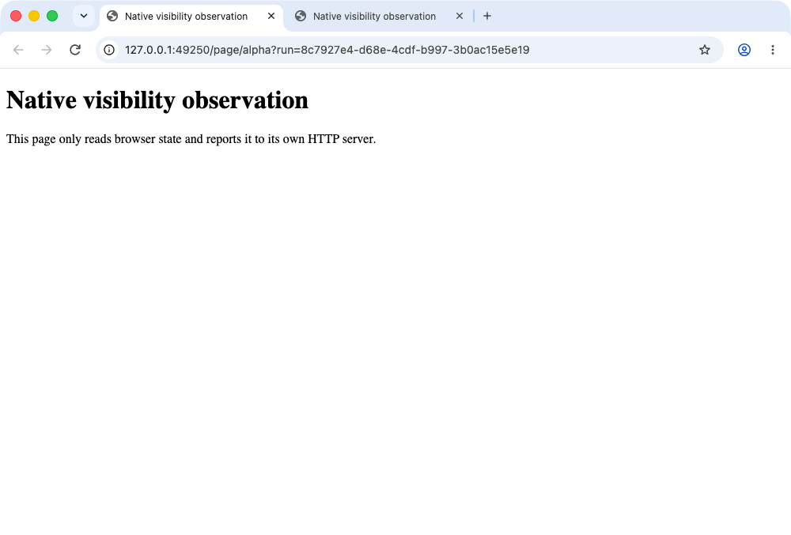
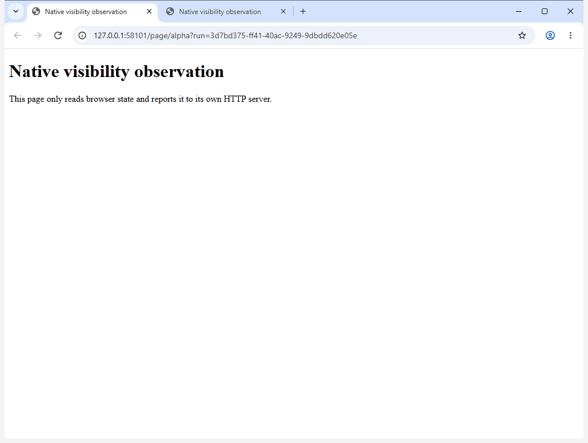

# Native browser UI review

## macOS Apple Silicon — reviewed 2026-11-03 IST

The actual custom app from `ci-source-e146fe41bca3`, extracted from the
252,685,495-byte ZIP with SHA-256
`7dbfafec37054e029848f1cedff431244b3031f96ae2cc6b076305119986d2b8`,
was captured during the native-default no-debug phase of
[delivery 41533441385](https://github.com/TheShahnawaaz/always-active-chromium/actions/runs/41533441385).
The normal launch had no debugging, automation, extension-loading or emulation
flags. Runtime and normal Store verification also passed on this delivered app.

Codex visually inspected this actual 1000×677 PNG, asset **703329654** in draft
**432019315**, SHA-256
`540fbca5d806231a06c3a759f8b8b60a6fd5b6a5caf89e8da0a12b142c1f6f52`.
The complete normal window shows standard Mac window controls, two Chromium
tabs, the navigation/address bar, bookmark, profile and menu controls. The
expected fixture heading and body are rendered. There are no added always-active
toolbar controls, badges or startup banners visible in this view. This is a
visual inspection of native package pixels, not a synthetic image or reference
Chrome result.

The receipt binds the exact executable/profile, PID 4687, kernel start identity
and owned foreground standard window ID `104`. Both permission preflights
already passed; no permission was requested or OS setting changed. AX and
window-server titles identify the fixture and remain individually unchanged
before/after capture. Their full strings differ; they need not equal each
other. Exact window-server ID, PID and AX/CG geometry remain mandatory. All
seven delivery assets, server sizes/digests and six checksum entries were
independently verified.

The automated reports retain their original `manualReview: pending` and
`uiEquivalenceVerified: false` values. The separate
[visual review record](releases/mac-arm64/visual-review.json) records this
subsequent inspection. It covers one light-mode normal-window view; it does not
claim pixel equality with proprietary Google Chrome, every theme/settings view,
browser-download Gatekeeper approval or OS security dialogs. Chromium branding
remains a documented product difference.

## Windows x64

The actual x64 app installed by the normal per-user mini-installer from
`ci-source-07fb6c3f9ed7` passed fresh delivery and normal Store verification in
[41663769161](https://github.com/TheShahnawaaz/always-active-chromium/actions/runs/41663769161).
Installer SHA-256:
`4e0ae88f4b45b1ea5e6c1725320fb5a851a25c63e42c299889dee2963aba0ad3`.

Codex visually inspected this actual **1044×788** PNG, asset **706095670** in
draft **432879456**, SHA-256
`b8fc371bfbe5de081acbaa416477e550d264adedc211739bbc2ee06efa495d19`.
The complete normal window shows standard Windows controls, two Chromium tabs,
navigation/address bar, bookmark, profile and menu controls, plus the rendered
expected fixture heading and body. No added always-active controls, badges or
startup banners appear. This is the actual installed custom browser, not the
earlier CFT reference window.

The receipt binds the per-user executable/profile, PID **1972**, kernel start
identity and foreground normal window handle **9017c**. Ownership, session,
title context and geometry were revalidated before/after the one window-only
`PrintWindow` flags-2 capture. All seven delivery assets and six checksum entries
were independently downloaded/hash verified.

The original automated pending-review fields remain unchanged. The separate
[visual review record](releases/win-x64/visual-review.json) records this inspection.
It covers one light-mode normal window and does not claim proprietary Chrome
pixel equality, every UI view/theme or downloaded-installer Windows approval UI.
